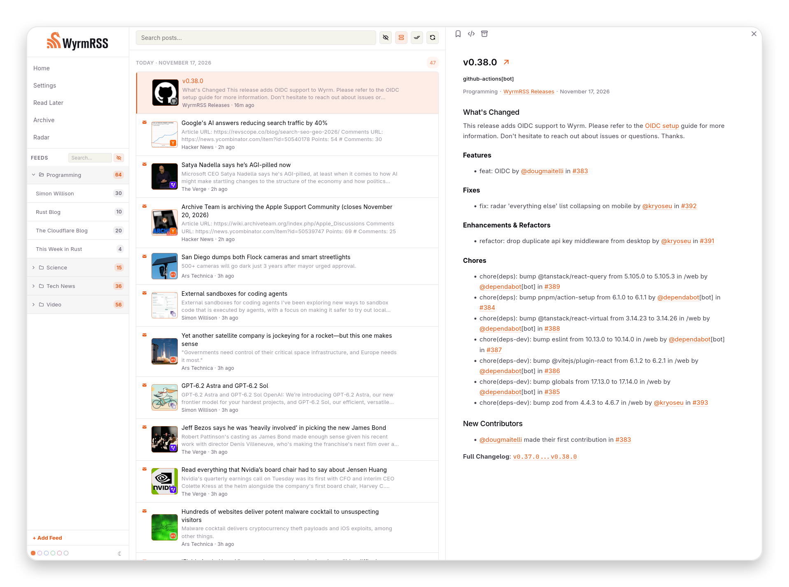

<p align="center">
  <picture>
    <source media="(prefers-color-scheme: dark)" srcset="site/src/assets/logo-on-dark.svg" width="65%">
    
  </picture>
</p>

<p align="center">
  <i>A self-hosted RSS reader and aggregator for web and mobile, also available as a desktop app.</i>
</p>

<p align="center">
  <a href="https://wyrmrss.com"><b>Documentation</b></a> · <a href="https://demo.wyrmrss.com"><b>Try the live demo</b></a><br>
  <sub>The demo is shared and mostly read-only, and resets daily.</sub>
</p>

<p align="center">
  <picture>
    <source media="(prefers-color-scheme: dark)" srcset=".github/assets/screenshot-dark.png">
    
  </picture>
</p>

## Features

- **Feed discovery**: paste a blog homepage or YouTube channel URL and Wyrm finds the feed
- **Video in the reader**: YouTube, HLS streams and Reddit videos play inline
- **Folders and OPML**: collapsible folders with unread counts, kept across OPML import and export
- **Display modes**: show each feed in your River, only on its own page, or on the quiet Radar
- **Filters**: include or exclude entries by URL, title or content, per feed
- **Read Later and archive**: save posts for later, archive the keepers, and search titles and descriptions
- **Keyboard shortcuts**: move, open, mark, save and archive without the mouse, all rebindable
- **Webhooks**: get notified about new posts on Discord, Slack or a custom endpoint
- **OIDC sign-in**: optional sign-in through your identity provider
- **Feeds behind authentication**: per-host basic auth or custom headers
- **RSSHub**: follow sites without RSS through your own instance
- **Feed health**: see failing feeds and their errors at a glance in Settings
- **Live settings**: change poll interval, timeouts, reading mode and post expiry without a restart
- **Desktop app**: macOS, Windows and Linux, with nothing to set up

## Installation

Try it with Docker Compose (PostgreSQL included):

```bash
curl -O https://raw.githubusercontent.com/kryoseu/WyrmRSS/main/templates/docker-compose.yaml
docker compose up -d
```

Then open http://localhost:3000. Other ways to install:

- [Desktop app](https://wyrmrss.com/getting-started/desktop/): macOS, Windows and Linux downloads
- [Docker](https://wyrmrss.com/getting-started/docker/): the Compose setup in detail
- [Kubernetes](https://wyrmrss.com/getting-started/kubernetes/): manifests for the server and web UI
- [Build from source](https://wyrmrss.com/getting-started/source/)

## Documentation

Configuration and guides are on [wyrmrss.com](https://wyrmrss.com):

- [Server configuration](https://wyrmrss.com/configuration/server/)
- [Runtime settings](https://wyrmrss.com/configuration/runtime-settings/)
- [OpenID Connect (OIDC)](https://wyrmrss.com/configuration/oidc/)
- [YouTube](https://wyrmrss.com/guides/youtube/)
- [Filters](https://wyrmrss.com/guides/filters/)
- [Feeds behind authentication](https://wyrmrss.com/guides/authenticated-feeds/)
- [Subscription links](https://wyrmrss.com/guides/subscription-links/)
- [RSSHub](https://wyrmrss.com/integrations/rsshub/)

## Stack

| Layer    | Technology                              |
|----------|-----------------------------------------|
| Backend  | Rust, Actix-web, Diesel, Tokio          |
| Database | PostgreSQL (self-hosted) / SQLite (desktop app) |
| Frontend | React, Vite, React Router v7, TanStack Query |
| Desktop  | Tauri                                   |

## Credits

Logo by [Pedro Niels](https://www.instagram.com/opedroniels/).

## Star History

<a href="https://www.star-history.com/?repos=kryoseu%2FWyrmRSS&type=date&legend=top-left">
 <picture>
   <source media="(prefers-color-scheme: dark)" srcset="https://api.star-history.com/chart?repos=kryoseu/WyrmRSS&type=date&theme=dark&legend=top-left&sealed_token=HFZ6f_QY-lCQIXL3wU7i9RhU_PAy8mbPXIQSh1Oigg-XyYosIvbOstQHU69deVQbPPUWzEp_v779rvHomnLzCQqo2nN7plx0aCJKIgEHqagjA9dnAUkP6nPIkn5cLlhCanOTylZMIXZ2-H-Wyyfk3FEQ_FMwG4ZjCwUUrqAIXqwRQmwd4keJjb8j6bu1" />
   <source media="(prefers-color-scheme: light)" srcset="https://api.star-history.com/chart?repos=kryoseu/WyrmRSS&type=date&legend=top-left&sealed_token=HFZ6f_QY-lCQIXL3wU7i9RhU_PAy8mbPXIQSh1Oigg-XyYosIvbOstQHU69deVQbPPUWzEp_v779rvHomnLzCQqo2nN7plx0aCJKIgEHqagjA9dnAUkP6nPIkn5cLlhCanOTylZMIXZ2-H-Wyyfk3FEQ_FMwG4ZjCwUUrqAIXqwRQmwd4keJjb8j6bu1" />
   
 </picture>
</a>

## License

GPL v3, see [LICENSE](LICENSE).
